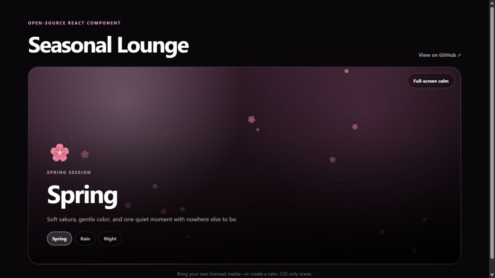

# Seasonal Lounge

[](https://github.com/harshwardhan1507/seasonal-lounge/actions/workflows/ci.yml)
[](https://seasonal-lounge.vercel.app/)
[](./LICENSE)

A configurable React lounge for seasonal video scenes, ambient audio highlights, particle effects, and a distraction-free full-screen calm mode.



Seasonal Lounge grew out of the interactive Lounge in [Harsh Wardhan's portfolio](https://harshwardhanportfolio.vercel.app). The library keeps the reusable experience while leaving all media choices to the application using it.

**[View the live demo →](https://seasonal-lounge.vercel.app/)**

## Features

- Interactive Visual Playground to customize atmospheres in real time
- Advanced Theme Builder for custom palettes, gradients, and typography
- Layered Effect Architecture (combine Sakura + Sparkles, Snow + Sparkles, etc.)
- Six curated theme presets (Sakura Dream, Cozy Autumn, Midnight Rain, Winter Silence, Golden Summer, Firefly Garden)
- Seasonal video backgrounds
- Optional ambient audio
- Highlight loops using exact start and end times
- Six included CSS-only presets: Autumn, Rain, Winter, Summer, Spring, and Night
- Sakura, leaves, rain, snow, sparkles, and fireflies
- Native full-screen mode with a fixed-position fallback
- Automatic muted video playback
- Responsive layout and accessible controls
- Reduced-motion support
- TypeScript definitions
- No bundled music or video

## Installation

```bash
npm install @harshwardhan1507/seasonal-lounge
```

Then import the component and styles:

```tsx
import {
  SeasonalLounge,
  seasonalPresets,
} from '@harshwardhan1507/seasonal-lounge';
import '@harshwardhan1507/seasonal-lounge/styles.css';

export function RestSpace() {
  return <SeasonalLounge seasons={seasonalPresets} initialSeasonId="spring" />;
}
```

The included presets are CSS-only, so they work without downloading media. To attach your own licensed audio or video, extend a preset or create a custom season:

```tsx
import {
  SeasonalLounge,
  type SeasonDefinition,
} from '@harshwardhan1507/seasonal-lounge';
import '@harshwardhan1507/seasonal-lounge/styles.css';

const seasons: SeasonDefinition[] = [
  {
    id: 'spring',
    label: 'Spring',
    description: 'Soft blossoms, gentle music, and a quiet moment.',
    videoSrc: '/media/spring.mp4',
    audioSrc: '/media/spring.mp3',
    audioSegment: { start: 23, end: 82 },
    effect: 'sakura',
    accent: '#f9a8d4',
    background: '#3b2030',
    symbol: '🌸',
  },
];

export function RestSpace() {
  return <SeasonalLounge seasons={seasons} initialSeasonId="spring" />;
}
```

## Theme Builder and layered effects

You can theme any season or lounge with `SeasonalTheme` and combine multiple effect layers:

```tsx
import {
  SeasonalLounge,
  themePresets,
  type SeasonDefinition,
} from '@harshwardhan1507/seasonal-lounge';
import '@harshwardhan1507/seasonal-lounge/styles.css';

// Use a built-in curated preset (Sakura Dream, Cozy Autumn, Midnight Rain, etc.)
export function DreamySpace() {
  return (
    <SeasonalLounge
      seasons={seasonalPresets}
      theme={themePresets.sakuraDream}
    />
  );
}

// Or define a bespoke seasonal theme with layered effects:
const customSeason: SeasonDefinition = {
  id: 'twilight-sakura',
  label: 'Twilight Sakura',
  description: 'Deep dusk tones with falling petals and gentle sparkles.',
  effects: [
    { effect: 'sakura', particles: { density: 35, speed: 1 } },
    { effect: 'sparkles', particles: { density: 15, speed: 0.8, direction: 'right' } },
  ],
  theme: {
    background: {
      type: 'gradient',
      gradient: 'linear-gradient(135deg, #1c1024 0%, #301438 50%, #0d0714 100%)',
    },
    colors: {
      primaryAccent: '#f472b6',
      particleColor: '#fbcfe8',
      textColor: '#ffffff',
    },
    typography: {
      fontFamily: 'Inter, system-ui, sans-serif',
      headingSize: '3rem',
    },
  },
};
```

## Included seasons

| Season | Effect | Mood |
| --- | --- | --- |
| Autumn | Falling amber leaves | Warm and mellow |
| Rain | Window rain | Soft and focused |
| Winter | Drifting snow | Bright and quiet |
| Summer | Golden sparkles | Sunny and unhurried |
| Spring | Sakura petals | Gentle and restorative |
| Night | Floating fireflies | Deep and thoughtful |

## Season configuration

| Property | Required | Description |
| --- | --- | --- |
| `id` | Yes | Stable season identifier |
| `label` | Yes | User-facing season name |
| `description` | Yes | Calm-space copy |
| `videoSrc` | No | Application-owned or licensed video URL; omit it for a CSS-only scene |
| `audioSrc` | No | Application-owned or licensed audio URL |
| `audioSegment` | No | Highlight loop `{ start, end }` in seconds |
| `effect` | No | `leaves`, `rain`, `snow`, `sparkles`, `sakura`, `fireflies`, or `none` |
| `accent` | No | Particle and selection color |
| `background` | No | CSS background used while media loads |
| `symbol` | No | Emoji, icon, or any React node |
| `particles` | No | Custom `ParticleSettings` (density, speed, size, opacity, direction) |

## Particle customization

Each season can configure particle animations independently with `ParticleSettings`:

```tsx
import {
  SeasonalLounge,
  type SeasonDefinition,
  type ParticleSettings,
} from '@harshwardhan1507/seasonal-lounge';
import '@harshwardhan1507/seasonal-lounge/styles.css';

const gentleBlossoms: SeasonDefinition = {
  id: 'gentle-spring',
  label: 'Gentle Spring',
  description: 'Soft sakura floating upwards in a spring breeze.',
  effect: 'sakura',
  accent: '#f9a8d4',
  particles: {
    density: 40,      // Number of particles: 0 to 100
    speed: 0.8,       // Animation speed multiplier: 0.25 to 3
    size: 22,         // Particle size in pixels
    opacity: 0.85,    // Particle transparency: 0 to 1
    direction: 'up',  // 'up' | 'down' | 'left' | 'right' | 'random'
  },
};
```

## Props

`SeasonalLounge` accepts:

- `seasons` — array of season definitions
- `initialSeasonId` — initially selected season
- `volume` — audio volume from `0` to `1` (default `0.42`)
- `allowFullscreen` — enable calm mode (default `true`)
- `showAudioControl` — show the sound button (default `true`)
- `showSeasonPicker` — show season choices (default `true`)
- `calmModeLabel` — customize the full-screen button label
- `onSeasonChange` — receive the newly selected season
- `className` and `style` — customize the root element

## Media and licensing

This package intentionally contains **no music, photos, or video**. Add only media that you created, licensed, or have permission to redistribute. The MIT license covers the source code in this repository, not media supplied by applications using the package.

## Local development

```bash
npm install
npm run check
npm run build
npm run pack:dry
```

## Contributing

Issues and pull requests are welcome. Please read [CONTRIBUTING.md](./CONTRIBUTING.md) before opening a change and follow the [Code of Conduct](./CODE_OF_CONDUCT.md).

## Developer

Seasonal Lounge was designed and developed by [Harsh Wardhan](https://harshwardhanportfolio.vercel.app). You can also find the developer on [GitHub](https://github.com/harshwardhan1507).

## License

[MIT](./LICENSE) © 2026 Harsh Wardhan
